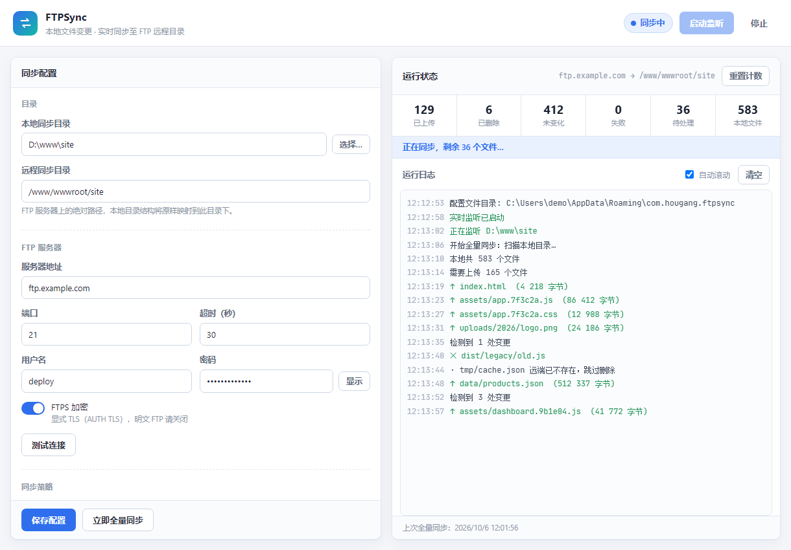

# FTPSync

把本地目录的文件变更**实时**同步到 FTP / FTPS 远程目录的 Windows 桌面工具。
带图形界面，无需命令行操作。

- 实时监听本地目录，新增 / 修改 / 删除自动同步到远端
- 单向镜像：本地删除，远端同步删除（可关闭）
- 可选严格镜像：清理远端存在但本地已不存在的文件
- 支持明文 FTP 与显式 FTPS（AUTH TLS）
- 忽略规则（glob），断线自动重连，增量判定，避免重复上传
- 界面实时显示同步进度、统计与分级日志



---

## 一、项目结构

```
ftp-sync/
├── sync-core/                  同步内核（不依赖界面框架，可独立测试/复用）
│   ├── src/config.rs           配置模型、忽略规则匹配
│   ├── src/ftp.rs              FTP/FTPS 客户端封装（含断线重连、目录列表解析）
│   ├── src/engine.rs           监听线程 + 工作线程 + 全量/增量同步
│   └── examples/e2e_sync.rs    端到端自检程序
├── src-tauri/                  桌面外壳（Tauri 2）
│   ├── src/lib.rs              IPC 命令、事件转发、原生目录选择
│   ├── src/main.rs             入口
│   ├── tauri.conf.json         窗口与打包配置
│   ├── capabilities/           权限声明
│   ├── icons/                  应用图标
│   └── make_icons.py           图标生成脚本（纯标准库，可重新生成）
├── ui/                         前端界面（原生 HTML/CSS/JS，无打包器）
│   ├── index.html
│   ├── style.css
│   ├── app.js
│   ├── preview.html            界面预览页（开发用）
│   └── tauri-mock.js           预览用的假桥接
├── tools/local_ftp_server.py   本地测试 FTP 服务器
└── package.json                仅用于引入 Tauri CLI
```

**分层原则**：所有同步逻辑在 `sync-core`，不引入任何 GUI 依赖；
`src-tauri` 只做「内核事件 → 前端事件」和「前端指令 → 内核对方法」的转发。
因此内核可以脱离界面独立跑端到端测试。

---

## 二、运行与构建

### 开发运行

```bash
npm install          # 仅安装 Tauri CLI
npm run dev          # 启动桌面应用（热重载前端）
```

### 打包安装程序

```bash
npm run build
# 产物：src-tauri/target/release/bundle/nsis/FTPSync_0.1.0_x64-setup.exe
```

### 端到端自检

需要一台可写的 FTP 服务器。用仓库自带的本地服务器最省事：

```bash
# 终端 A：启动本地 FTP（依赖 pyftpdlib）
pip install pyftpdlib
python tools/local_ftp_server.py      # ftp://127.0.0.1:2121  test / test123

# 终端 B：跑自检
npm run e2e
```

自检会依次验证：连通性 → 首次全量同步 → 修改上传 → 新增上传 →
删除镜像 → 清理远端多余文件，并对每一步做断言。

可用环境变量覆盖：`E2E_FTP_HOST` `E2E_FTP_PORT` `E2E_FTP_USER`
`E2E_FTP_PASS` `E2E_FTP_SECURE` `E2E_LOCAL` `E2E_REMOTE`。

### 界面预览（不起桌面窗口）

```bash
npm run preview      # 打开 http://127.0.0.1:8899/preview.html
```

---

## 三、使用说明

界面分左右两栏：左侧填配置，右侧看状态与日志。

### 1. 目录

| 字段 | 说明 |
| --- | --- |
| 本地同步目录 | 被监听的本地文件夹，点「选择…」挑目录 |
| 远程同步目录 | FTP 服务器上的绝对路径，本地目录结构原样映射到其下 |

例：本地 `D:\www\site` 下的 `assets/a.js`，在远程 `/www/wwwroot/site` 下
对应 `/www/wwwroot/site/assets/a.js`。

### 2. FTP 服务器

| 字段 | 说明 |
| --- | --- |
| 服务器地址 | 域名或 IP，如 `ftp.example.com` |
| 端口 | 明文 FTP 通常 21；显式 FTPS 通常也是 21 |
| 用户名 / 密码 | FTP 账号 |
| 超时（秒） | 连接与操作超时，默认 30 |
| FTPS 加密 | 打开走显式 TLS（AUTH TLS）；服务器不支持就关掉 |

填好后点「测试连接」，会返回服务器登录目录与同步根目录的条目数，
用于确认路径和权限是否正确。

> 传输模式固定为**二进制 + 被动模式**，这是跨公网最稳的组合。

### 3. 同步策略

| 开关 | 默认 | 说明 |
| --- | --- | --- |
| 镜像删除 | 开 | 本地删除文件后，远端对应文件一并删除 |
| 严格镜像（清理远端多余文件） | 开 | 全量同步时删除远端存在、本地已不存在的文件。**这会删除服务器上的文件，请确认远程目录是同步目标而非共享目录** |
| 开机自动监听 | 关 | 应用启动后自动开始监听 |
| 启动时全量同步 | 开 | 开始监听时先比对一次全部文件 |

- **事件防抖**：文件停止变动后等待该时长再上传，默认 800ms。
  调大可以避免大文件写入过程中被传成半成品，调小则响应更快。
- **忽略规则**：每行一条 glob，命中任意层级即忽略。默认忽略
  `*.tmp` `*.swp` `*~` `~$*` `.DS_Store` `Thumbs.db` `.git` `node_modules`。

### 4. 运行

- **启动监听**：保存当前配置并开始监听（配置有改动会自动先保存）。
- **立即全量同步**：手动触发一次全量比对。
- **停止**：停止监听并断开连接，已同步的内容不受影响。
- **重置计数**：把统计数字归零，便于观察下一轮。

运行日志按级别着色：绿色为成功操作，灰色为普通信息，橙色为警告
（如「远端已不存在，跳过删除」），红色为失败。

---

## 四、实现要点

### 增量判定

内核维护一份本地索引（`ftpsync-index.json`，存在应用配置目录，
不会污染被同步的目录），记录每个文件的大小与修改时间。
判断「是否需要上传」只比对本地文件与索引，**无需读取远端元数据**，
省掉大量 `MDTM` / `SIZE` 往返。

### 线程模型

| 线程 | 职责 |
| --- | --- |
| 监听线程 | 持有文件系统观察器，累积原始事件，做静默期防抖后派发任务 |
| 工作线程 | 独占一个 FTP 会话，串行消费任务队列 |

FTP 控制连接不能并发复用，因此任务串行执行；防抖采用「静默期」策略，
文件持续变动时最多等待 `防抖时长 × 12` 强制冲刷一次，避免饥饿。

### 可靠性处理

- **断线重连**：每个 FTP 操作失败后自动重连并重试一次；
  长连接在空闲后容易被服务器断开，这层包装让上层逻辑无感知。
- **目录列表兼容**：优先按 POSIX 格式解析，失败则回退 DOS 格式，
  兼容 Linux 与 Windows 的 FTP 服务端。
- **删除竞态**：远端文件已不存在（550）时按「跳过」处理而非报错，
  避免统计里堆满无意义的失败。
- **相对路径事件**：监听根目录会被转成绝对路径，
  否则文件系统事件（绝对路径）无法正确截取出相对路径，事件会被静默丢弃。

---

## 五、已知限制

- 仅支持**单向**同步（本地 → 远程），不做远端改动回拉。
- 不支持 SFTP（SSH 通道）。若目标服务器只开放 SFTP，需要另加协议实现。
- 不支持隐式 FTPS（端口 990，已废弃的隐式 TLS 模式）。
- 大文件在传输过程中若被再次修改，本次上传的是修改前的快照，
  下一次事件会重新上传；防抖时长调大可降低这种情况的概率。
- 未做文件级冲突检测（单向同步下不存在冲突语义）。

---

## 六、许可证

[MIT](LICENSE)

